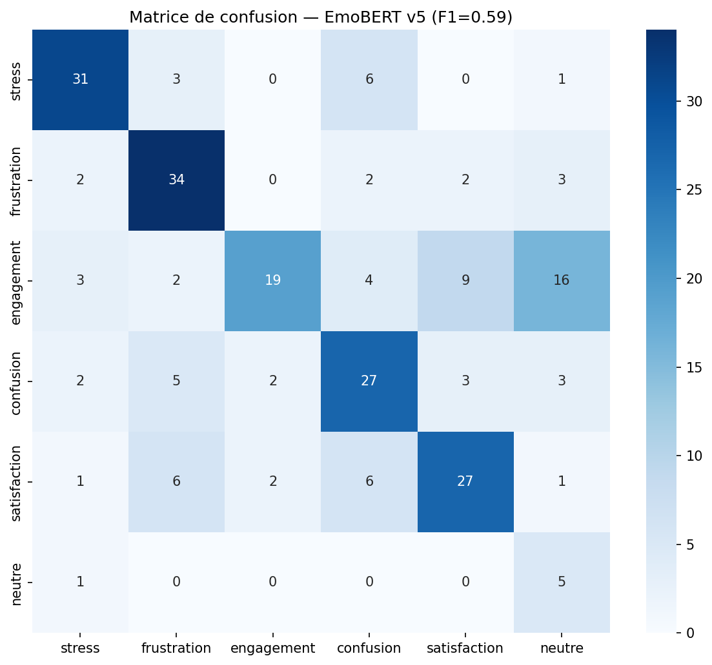
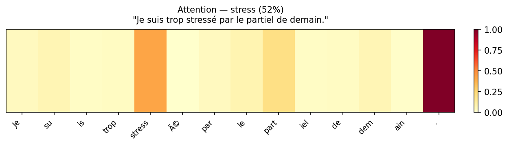

# Tuteur conversationnel émotionnel et explicable

> Mémoire de Master 1 Langue et Informatique (TAL) – Sorbonne Université, 2025/2026
> Projet réalisé en binôme : **Sara Hadidi** & **Zinedine Hamadi**
> Article co-écrit soumis à la conférence **MMM 2027**

Un tuteur conversationnel qui **détecte l'état émotionnel de l'apprenant** (stress, frustration, confusion…), **adapte sa réponse** en conséquence grâce à un LLM, et **explique ses décisions** en langage naturel.

---

##  Le problème

Un apprenant bloqué, stressé ou démotivé n'a pas besoin de la même réponse qu'un apprenant engagé. Les assistants classiques répondent toujours de la même façon. Ce projet ajoute une couche « émotionnelle » et **explicable** au dialogue pédagogique.

##  Architecture

```
Message de l'apprenant
        │
        ▼
┌──────────────────┐     ┌───────────────────┐     ┌──────────────┐
│ EmoBERT          │ ──▶ │ Prompt Builder    │ ──▶ │ LLM          │ ──▶ Réponse adaptée
│ (classification  │     │ (stratégie selon  │     │ (génération) │
│  de l'émotion)   │     │  l'émotion)       │     └──────────────┘
└──────────────────┘     └───────────────────┘
        │
        ▼
┌──────────────────┐
│ Module XAI       │ ──▶ Explication en langage naturel
│ (attention +     │     (« J'ai repéré les mots … »)
│  templates)      │
└──────────────────┘
```

1. **EmoBERT** – classifieur fine-tuné à partir de RoBERTa (6 classes : stress, frustration, engagement, confusion, satisfaction, neutre). Un **seuil de confiance** évite d'agir sur une prédiction incertaine (repli sur « neutre »).
2. **Prompt Builder** – choisit une stratégie pédagogique selon l'émotion détectée (`pipeline/strategies.yaml`) : ton rassurant en cas de stress, exemple concret en cas de frustration, etc.
3. **LLM** – génère la réponse du tuteur (Zephyr-7B dans le notebook Colab ; client compatible OpenAI dans la version locale).
4. **Module d'explicabilité (XAI)** – identifie les mots qui ont le plus pesé dans la décision (attention) et les insère dans une explication rédigée (`xai/xai_templates.yaml`).

##  Structure du dépôt

| Dossier | Contenu |
|---|---|
| `corpus/` | Construction du corpus : téléchargement et fusion (EmpathicDialogues, DailyDialog), filtrage, extraction pour annotation, calcul de l'accord inter-annotateurs |
| `emobert/` | Entraînement du classifieur (rééquilibrage des classes, contexte multi-tours) et analyse des erreurs |
| `pipeline/` | Tuteur complet : classifieur → prompt → LLM, avec historique de dialogue |
| `xai/` | Module d'explicabilité et exemples de cartes d'attention |
| `docs/` | Matrice de confusion, analyse qualitative et causes des erreurs |

##  Démarche

- **Corpus** : dialogues issus d'EmpathicDialogues et DailyDialog, filtrés puis annotés à la main selon une grille d'émotions pédagogiques ; qualité vérifiée par **accord inter-annotateurs**.
- **Modèle** : fine-tuning en deux étapes, amélioré au fil de **cinq versions** (rééquilibrage des classes, augmentation de données, pondération, contexte multi-tours, seuil de confiance).
- **Évaluation** : métriques par classe, matrice de confusion et **analyse qualitative des erreurs**. La majorité des erreurs vient de l'**ambiguïté du contexte** (un message court comme « Is that difficult ? » peut exprimer plusieurs états).

##  Aperçu

| Matrice de confusion | Explicabilité (attention) |
|---|---|
|  |  |

##  Lancer le projet

```bash
pip install -r pipeline/requirements.txt
export OPENAI_API_KEY="votre_cle"   # jamais écrite dans le code
cd pipeline
python pipeline.py
```

Les poids du modèle EmoBERT ne sont pas inclus (trop volumineux). Les notebooks Colab (`pipeline/pipeline_colab.ipynb`, `xai/xai_colab.ipynb`) permettent de reproduire l'entraînement et les démonstrations sur GPU.

##  Ma contribution (Sara Hadidi)

- Classifieur **EmoBERT** : entraînement, versions successives et analyse des erreurs
- **Module d'explicabilité** (attention + explications en langage naturel)
- Constitution, annotation et évaluation du corpus

##  Technologies

Python · PyTorch · Hugging Face Transformers · RoBERTa · LLM (Zephyr-7B) · pandas · scikit-learn · YAML · Google Colab

##  Données

Les corpus sources (EmpathicDialogues, DailyDialog) sont téléchargés depuis Hugging Face et restent soumis à leurs licences respectives ; les données brutes ne sont pas redistribuées ici.
